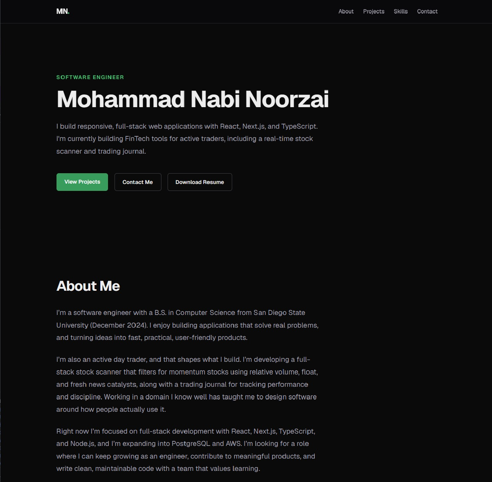

# Developer Portfolio: Mohammad Nabi Noorzai

My personal portfolio site, built with Next.js, TypeScript, and Tailwind CSS. It gives recruiters and hiring managers one place to see my projects, skills, and resume, and to contact me.

**Live site:** https://mnoorzai.vercel.app



## Features

- Responsive single-page layout with a mobile menu for small screens
- Projects, skills, and social links rendered from typed data files, so adding a project means editing one file
- One-click resume download (PDF)
- Link preview card for LinkedIn, Slack, and other sites, using an Open Graph image generated at build time
- Accessible: semantic HTML, visible keyboard focus, and smooth scrolling that respects reduced-motion settings

## Tech Stack

- **Frontend:** Next.js 16 (App Router), React, TypeScript, Tailwind CSS, Geist font
- **Backend:** None yet; every page is statically rendered at build time (a contact form using a Server Action is planned)
- **Database:** None; content lives in TypeScript files in `src/data/`
- **Testing & CI:** ESLint and TypeScript type checking (`npm run build`); Vercel builds a preview deployment for every pull request
- **Hosting:** Vercel, deploying automatically on every merge to `main`

## How It Works

```
src/data/*.ts  →  src/components/*.tsx  →  src/app/page.tsx  →  next build (static HTML)  →  Vercel
 (content)          (UI sections)            (page layout)
```

- **Content is separate from the UI.** Each section reads its data from `src/data/` (for example `projects.ts`), so updating content never touches component code.
- **Server Components by default.** Only `MobileMenu` is a Client Component (`"use client"`), because it needs `useState` to open and close; everything else ships as plain HTML with no JavaScript.
- **SEO and sharing are handled by the App Router.** `layout.tsx` sets the metadata, canonical URL, and Open Graph tags, and `opengraph-image.tsx` generates the 1200×630 preview image.

## Getting Started

### Prerequisites

- Node.js 20.9 or later
- npm

### Install

```bash
git clone https://github.com/mnoorzai21/nabi-portfolio.git
cd nabi-portfolio
npm install
```

### Configure

No environment variables are needed. The site URL used for metadata is set in `src/app/layout.tsx` (`metadataBase`).

### Run

```bash
npm run dev
```

Open http://localhost:3000.

### Test

```bash
npm run lint    # ESLint
npm run build   # production build with full type checking
npm run start   # serve the production build locally
```

## Deployment

The site is hosted on Vercel and deploys automatically on every merge to `main`.

1. In Vercel, **Add New → Project** and import this GitHub repository.
2. Keep the detected settings (Framework Preset: **Next.js**, default build command). No environment variables are needed.
3. Click **Deploy**.
4. In **Settings → Domains**, set the project domain (here: `mnoorzai.vercel.app`). The old domain redirects to it.
5. Make sure `metadataBase` in `src/app/layout.tsx` matches the domain, so link previews use the right absolute URLs.
6. After changing the preview image or title, refresh LinkedIn's cached preview with the [LinkedIn Post Inspector](https://www.linkedin.com/post-inspector/).

## What I Learned

- **Link previews need absolute URLs.** Setting `metadataBase` made Next.js output the full `og:image` URL. Locally, the tag seemed missing because `npm run start` was serving an old build; rebuilding fixed it.
- **Not every console error comes from my code.** A hydration-mismatch warning listed `data-darkreader-*` and `data-gr-*` attributes; testing in an incognito window proved the Dark Reader and Grammarly extensions caused it.
- **Tailwind classes must be complete and exact.** A single space in `sm: flex` silently broke the desktop navigation; designing mobile-first with `hidden sm:flex` fixed the header overflow on phones.
- **A professional Git workflow.** Every change went through a feature branch, a pull request with a description, and a squash merge with a Conventional Commits title.

## Author

**Mohammad Nabi Noorzai**

- GitHub: [@mnoorzai21](https://github.com/mnoorzai21)
- LinkedIn: [Mohammad Nabi Noorzai](https://linkedin.com/in/mnoorzai21)
- Portfolio: [mnoorzai.vercel.app](https://mnoorzai.vercel.app)